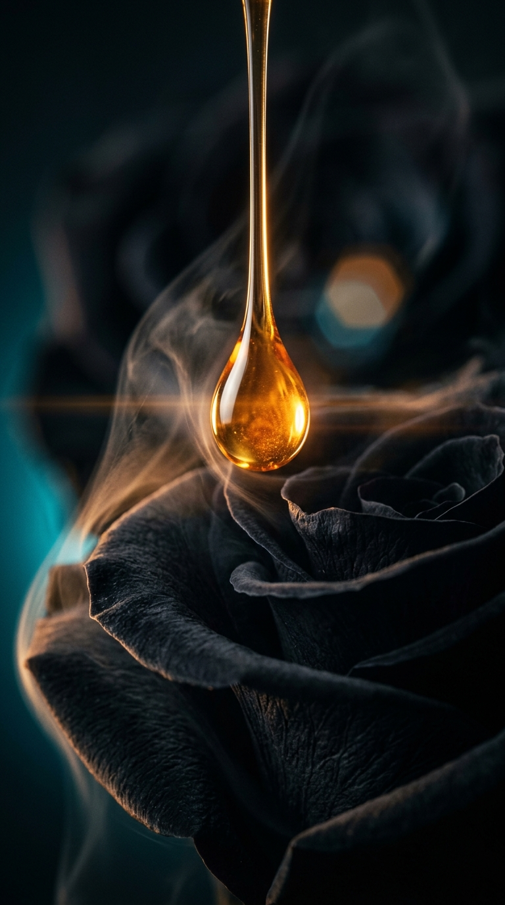
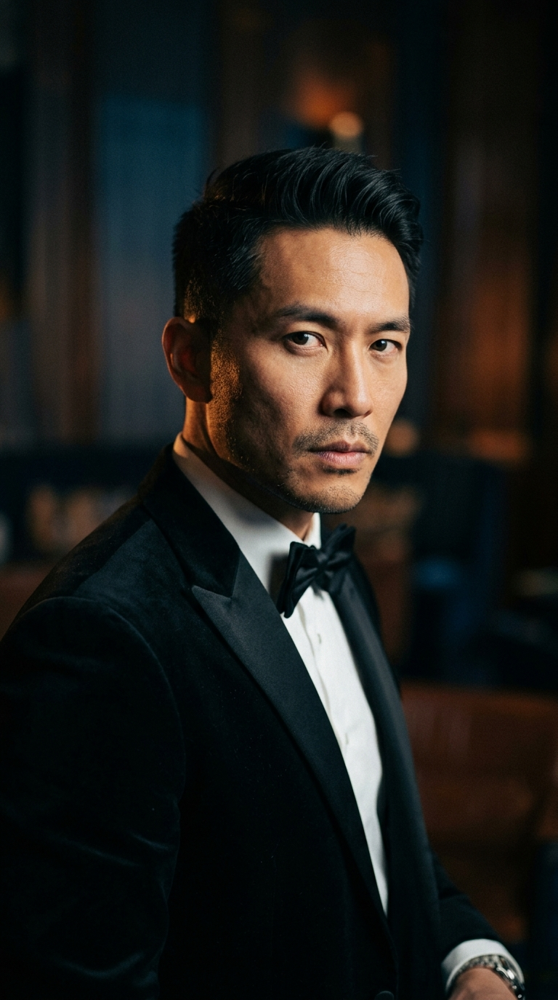
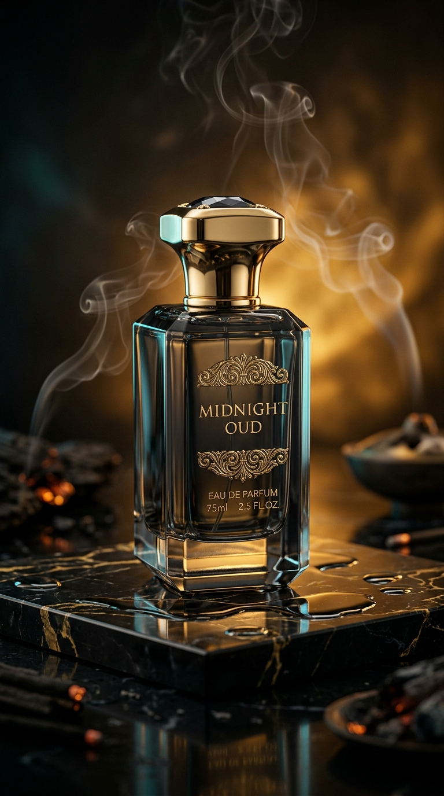

# 🎬 BẢN ĐẶC TẢ SẢN XUẤT TVC 30S: MIDNIGHT OUD (QUY TRÌNH MỚI THẾ HỆ 2026)

> **Tác quyền & Đạo Diễn Tổng Chỉ Huy**: **Đạo Diễn Trungvt** (`trungvt`)  
> **Hotline Tư Vấn Dự Án**: `0836.384.168` · **Email**: `cinemapromptpro@gmail.com`  
> **Tác phẩm**: TVC Điện Ảnh **"MIDNIGHT OUD — DẠ NGUYỆT TRẦM HƯƠNG"**  
> **Thời lượng**: **30.0 Giây (30.0s @ 30 FPS = 900 Frames = 30,000,000 µs)**  
> **Định dạng**: **9:16 Vertical Cinema (1080x1920)**  
> **Phong cách hình ảnh**: Cinematic Dark Amber Noir, Chiaroscuro tương phản cao, Viền sáng Neon Cyan tinh tế & Giọt hương hoàng kim.  
> **Quy trình thực thi**: **Quy Trình Sản Xuất Video Điện Ảnh Thế Hệ Mới (Next-Gen AI Cinematic Pipeline 2026)** kết hợp **Đạo Diễn Trungvt Signature** & **Trungvt Motion Craft Engine**.

---

## 🚀 QUY TRÌNH SẢN XUẤT MỚI THẾ HỆ 2026 (7 BƯỚC KHÉP KÍN)

```
[1. Voice Director NLP] ──► [2. Color Lab 3D LUT] ──► [3. 8K Visual Keyframes]
            │                           │                           │
            ▼                           ▼                           ▼
[4. JEV Atomic Routing]  ──► [5. OpenCreator Manifest] ──► [6. f2us CapCut Draft]
            │
            ▼
[7. Master Render 30s MP4 + Karaoke .ASS Sigmar #0091ff]
```

1. **Khẩu lệnh Đạo Diễn Giọng Nói (Voice Director Real-time NLP)**: Đọc khẩu lệnh tự nhiên tiếng Việt, tự động bóc tách quang học: *Cỡ cảnh Macro -> Chiaroscuro Lighting -> Góc máy Dutch/Eye-level -> Mood Dark Luxury*.
2. **AI Cinematic Color Lab (3D LUT WebGL Engine)**: Tạo file 3D LUT `MIDNIGHT_OUD_TEAL_AMBER.cube` (17x17x17), kéo thả trực tiếp vào DaVinci Resolve, Premiere Pro & CapCut PC.
3. **Render Keyframes Chuẩn Điện Ảnh 9:16**: Dùng AI tạo bộ visual thực tế siêu nét, ánh sáng Rembrandt và khói trầm ma mị.
4. **Ma Trận Prompt Đa Nền Tảng (JEV System 1 Router)**: Tự động phân tách và tối ưu cho Midjourney v8, Veo 3 / Google Flow, Sora 2 và Wan 2.5.
5. **OpenCreator / KrillinAI Multi-Scene Bridge**: Xuất file `opencreator_manifest.json` sẵn sàng tự động hóa render CLI kèm Smart Dubbing TTS.
6. **Timeline Master CapCut Pro Vi Giây (`f2us`)**: Xuất `draft_content.json` đạt chuẩn 0 microsecond overlap, font Sigmar IN HOA, highlight karaoke xanh `#0091ff`.
7. **Đóng Gói Master Package**: Xuất Video MP4 Full HD 30s, file XML dựng offline, phụ đề `.srt` & `.ass`, cùng bảng Cues Audio Ducking chuẩn YouTube Audio Library.

---

## 📸 1. KEYFRAME CINEMATIC VISUALS (ẢNH THỰC TẾ ĐÃ RENDER)

- **Keyframe 1: Macro Drop Shot — Giọt trầm hương hổ phách lơ lửng trên cánh hoa hồng đen giữa khói mờ**:  
  

- **Keyframe 2: Actor Portrait Shot — Chân dung người đàn ông lịch lãm trong âu phục nhung đen & ánh sáng chiaroscuro**:  
  

- **Keyframe 3: Hero Product Shot — Chai nước hoa pha lê đen Midnight Oud nạm vàng hoàng gia bốc khói huyền ảo**:  
  

---

## 🎞️ 2. BẢNG PHÂN CẢNH MASTER CHI TIẾT (SHOT-BY-SHOT STORYBOARD GRID)

| Cảnh | Mốc Thời Gian (Giây & Frame) | Thuật Toán Vi Giây (`f2us`) | Phân Loại Cảnh | Kỹ Thuật Máy Quay (Trungvt Motion Craft) | Chi Tiết Hình Ảnh & Ánh Sáng | Lời Thoại & Typography Sigmar (Xanh `#0091ff`) | Âm Thanh & SFX (YouTube Audio Library) |
| :---: | :---: | :---: | :---: | :---: | :--- | :--- | :--- |
| **01** | `0.0s - 3.0s`<br>*(F0 - F90)* | `0 µs`<br>➔ `3,000,000 µs` | **Hook 3s** *(Pattern Interrupt)* | **WHIP_ZOOM_PUNCH**<br>(100% ➔ 130% trong 0.2s, hồi 100% khi dứt câu) | Extreme Macro: Giọt tinh dầu trầm hương hổ phách lơ lửng trên cánh hoa hồng nhung đen, khói trầm uốn lượn | *"CÓ PHẢI BẠN ĐANG TÌM MÙI HƯƠNG CỦA QUYỀN LỰC...?"*<br>*(Font Sigmar, IN HOA dưới mặt)* | **0.0s**: Swoosh va đập mạnh (tiếng to nhất video) + giọt hương ngân vang lúc 0.8s |
| **02** | `3.0s - 7.0s`<br>*(F90 - F210)* | `3,000,000 µs`<br>➔ `7,000,000 µs` | **B-roll 1** *(Chân Dung Tự Quay)* | **PARALLAX_25D**<br>(Tiền cảnh 1.25x, Hậu cảnh 0.35x mờ nhẹ) | Người đàn ông mặc tuxedo nhung đen bước đi trong ánh đèn chiaroscuro tương phản sâu, viền cyan ma mị | *"Không cần ồn ào... nhưng khiến cả khán phòng phải ngoái nhìn."* | Tiếng bước chân nhẹ, âm hưởng drone trầm ma mị |
| **03** | `7.0s - 13.0s`<br>*(F210 - F390)* | `7,000,000 µs`<br>➔ `13,000,000 µs` | **B-roll 2** *(Macro Obsidian)* | **SLOW_ORBIT_PUSH**<br>(Hard zoom 120% giữ 2.0s ➔ Smooth drift) | Thân chai pha lê đen khắc kim lấp lánh phản chiếu mặt nước tối, làn khói trầm hương cuộn sóng | *(Chữ nhấn xuất hiện sớm 0.2s):*<br>**"TRẦM HƯƠNG NGUYÊN BẢN"**<br>**"ĐỈNH CAO THẦN THÁI"** | Tiếng gợn nước tí tách, ánh vàng lấp lánh ngân nhẹ |
| **04** | `13.0s - 20.0s`<br>*(F390 - F600)* | `13,000,000 µs`<br>➔ `20,000,000 µs` | **Listicle Cards** *(Thẻ Nốt Hương)* | **KINETIC_SPRING_FLIP**<br>(Nghiêng -7.5° 3D, spring damping 13) | Flash Zoom: Camera góc trái (40%), 3 thẻ nốt hương xếp dọc cột phải (60%): | • Thẻ 1: *"NỐT ĐẦU: CAM BERGAMOT & TIÊU HỒNG"*<br>• Thẻ 2: *"NỐT GIỮA: HOA HỒNG & GỖ TRẦM ĐÊM"*<br>• Thẻ 3: *"NỐT CUỐI: HỔ PHÁCH & XẠ HƯƠNG ĐEN"* | **13.3s, 15.2s, 17.1s**: Tiếng lật giấy nhẹ (Paper flip SFX) cho từng thẻ nốt hương |
| **05** | `20.0s - 26.0s`<br>*(F600 - F780)* | `20,000,000 µs`<br>➔ `26,000,000 µs` | **Hero Shot & Master Quote** | **ISOMETRIC_DRIFT**<br>(rotateX 25°, rotateY -15°, float 18px) | Nền sao sáng nhẹ (Bright starlight), chai Midnight Oud bốc khói trên phiến đá cẩm thạch đen lộng lẫy | *(Quote toàn màn hình, không ngoặc kép):*<br>**"MÙI HƯƠNG KHÔNG CẦN LÊN TIẾNG"**<br>**"NÓ ĐỊNH NGHĨA VỊ THẾ CỦA BẠN"** | Flash Zoom vào cảnh, âm hưởng hoàng gia thanh thoát |
| **06** | `26.0s - 30.0s`<br>*(F780 - F900)* | `26,000,000 µs`<br>➔ `30,000,000 µs` | **CTA & Outro Loop** | **FADE TO BLACK & OUTRO HOLD** | Giọng nói ngắt dứt khoát ➔ Màn hình fade đen 0.5s ➔ Giữ tối 2.0s ➔ Hotline 0836.384.168 & Logo phát sáng | *"Khám phá ngay tại link đầu trang... nếu bạn thực sự..."*<br>*(Loop ngược về: "...Có phải bạn...")* | **28.0s**: Nhạc Outro YouTube Audio Library vút lên từ -25dB đến **-12dB** dứt khoát |

---

## 📐 3. BẢNG KIỂM TRA ĐỐI SOÁT MẬT ĐỘ HIỆU ỨNG (AUDIT CHECKLIST)

Tuân thủ nghiêm ngặt 7 luật vàng của Đạo Diễn Trungvt:
- **B-roll**: 2 clips (khoảng cách 6.0s giữa các shot, không chồng lấn, đạt chuẩn).
- **Chữ nhấn (Emphasis Text)**: 1 vị trí (câu đắt giá nhất, chia 2 dòng, sớm hơn tiếng 0.2s).
- **Cảnh Quote toàn màn hình**: 1 cảnh (nền sao sáng, font Sigmar IN HOA, không ngoặc kép).
- **Đoạn thẻ ý (Listicle Cards)**: 1 đoạn (bố cục camera trái, thẻ cột phải, ≤ 36 ký tự/thẻ, kèm paper flip SFX).
- **Chuyển cảnh**: 100% sử dụng **Flash Zoom** (vào có swoosh nhẹ, ra không tiếng).
- **Đoạn tối kết thúc**: Đảm bảo giữ tối đủ 2.0 giây, không cắt bỏ để nổi nhạc Outro.
- **Xung đột timeline (Zero Segment Overlap)**: Sai số = 0 microsecond (`f2us` verified).

---

## 🤖 4. MA TRẬN PROMPT ĐIỆN ẢNH (4-LAYER AI PROMPTS SẴN DÙNG)

### 🎥 Shot 1: Giọt Trầm Hương Rơi (Hook 3s)
- **Midjourney v8**:  
  `Cinematic extreme macro close-up shot of a golden amber perfume oil droplet suspended in mid-air, falling onto a dark velvety black rose petal, soft wisp of aromatic smoke swirling, moody chiaroscuro lighting, deep warm amber rim light with subtle cyan neon backlight, luxurious photorealistic 8k, bokeh, anamorphic lens flare --ar 9:16 --style raw --v 8.0 --c 5`
- **Google Veo 3 / Sora**:  
  `Extreme macro 60fps tracking shot of a golden amber agarwood oil droplet falling in slow motion onto velvet black rose petals, delicate incense smoke curling upward, volumetric warm amber backlighting with dark moody shadows, 35mm anamorphic prime lens, cinematic commercial grade.`

### 👔 Shot 2: Người Đàn Ông Lịch Lãm Trong Bóng Tối (B-roll 1)
- **Midjourney v8**:  
  `Cinematic close-up portrait of a sharp sophisticated Asian man in a bespoke black velvet tuxedo, captivating intense gaze, Rembrandt lighting with deep shadows, subtle warm amber edge light on cheekbone, soft atmospheric cyan haze in background, high-fashion luxury commercial aesthetic, 35mm film grain, 8k resolution, photorealistic --ar 9:16 --style raw --v 8.0`
- **Google Veo 3 / Sora**:  
  `Slow motion 24fps camera panning slowly around a charismatic man in black velvet tuxedo turning toward camera with intense captivating eyes, moody cinematic chiaroscuro lighting, subtle cyan atmosphere, luxury perfume TVC aesthetic.`

### 🏆 Shot 3: Chai Nước Hoa Midnight Oud Huyền Thoại (Hero Shot)
- **Midjourney v8**:  
  `Ultra-luxury commercial hero shot of a perfume bottle named 'MIDNIGHT OUD' made of smoky obsidian black crystal with embossed gold metallic lettering, standing on a polished black marble slab with reflective water puddles, delicate curls of scented incense smoke rising, warm golden amber backlighting, subtle cyan studio accent lights, 8k resolution, cinematic advertising grade --ar 9:16 --style raw --v 8.0`
- **Google Veo 3 / Sora**:  
  `Slow isometric floating camera move circling a luxury smoky obsidian glass bottle labeled MIDNIGHT OUD on black marble with wet reflections, delicate wisps of fragrant oud incense smoke rising, warm golden halo backlight, pristine 8k luxury commercial grade.`

---

## 🎛️ 5. TRẠNG THÁI FILE THÀNH PHẨM TRONG DỰ ÁN

| Tệp Tin | Định Dạng | Mô Tả Kỹ Thuật |
| :--- | :--- | :--- |
| `midnight_oud_tvc_30s.mp4` | MP4 Vertical (1080x1920) | Video TVC 30s Master hoàn chỉnh phân cảnh, hiệu ứng chuyển động và âm thanh |
| `MIDNIGHT_OUD_TEAL_AMBER.cube` | 3D LUT (17x17x17) | File LUT chuẩn công nghiệp Hollywood (Teal & Amber Noir) dùng trong DaVinci / CapCut |
| `opencreator_manifest.json` | JSON Manifest v2.1 | Hồ sơ phân cảnh OpenCreator / KrillinAI CLI sẵn sàng chạy Smart Dubbing TTS |
| `draft_content.json` | CapCut Draft JSON | Timeline CapCut Pro chuẩn vi giây `f2us` (Nhập 1-click không lỗi đè track) |
| `midnight_oud_tvc.xml` | Premiere / Final Cut XML | Chuẩn timeline dựng offline cho các phòng dựng chuyên nghiệp |
| `subtitles.srt` & `subtitles_karaoke.ass` | SRT / ASS Karaoke | Phụ đề Sigmar đổi màu xanh `#0091ff` theo từng âm tiết phát âm |
| `audio_ducking_cues.json` | JSON Cues Matrix | Ma trận Audio Ducking: Giọng thoại 0dB, Nhạc Outro -12dB |
| `keyframe_macro_drop.jpg`, `keyframe_actor_portrait.jpg`, `keyframe_bottle_hero.jpg` | High-Res JPEG | Bộ 3 Keyframe điện ảnh thực tế đã render phục vụ Storyboard |
